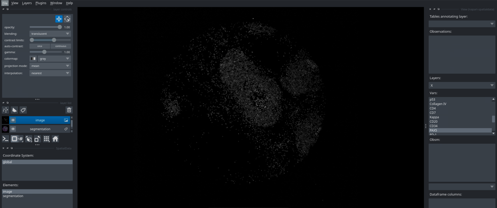
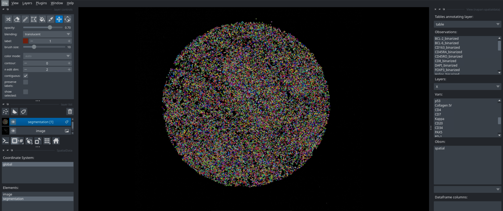
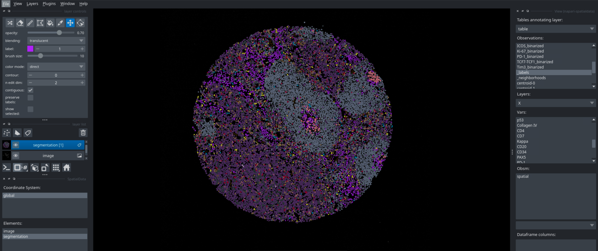
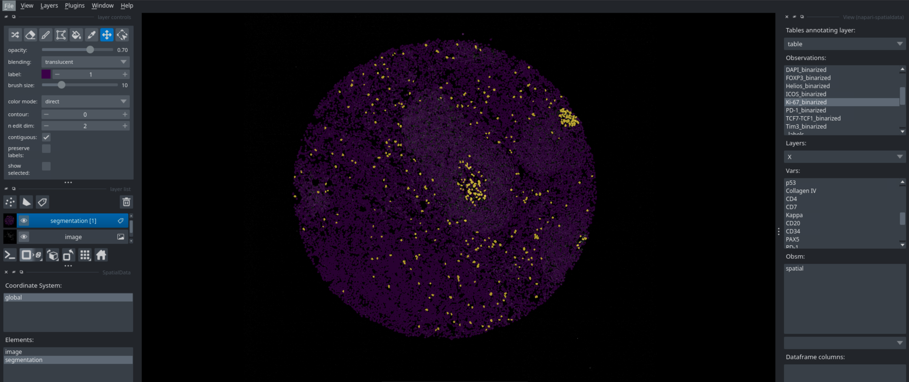
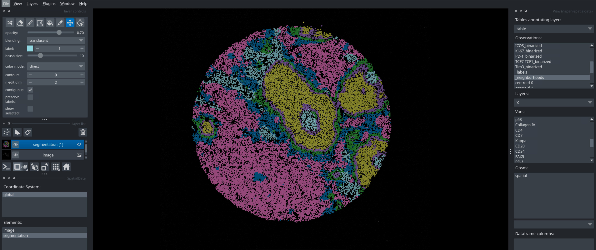
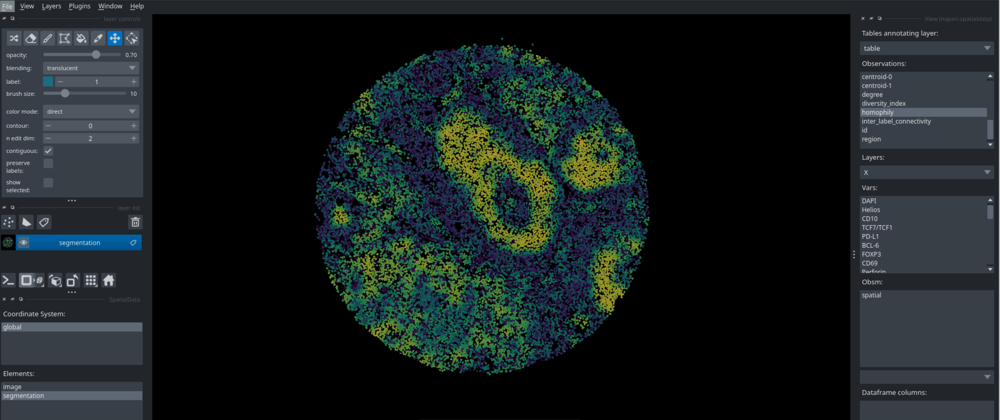

# Interactivity with napari

*Spatialproteomics* has a variety of functions to ensure interoperability with existing tools. For example, we can export the *spatialproteomics* object into *spatialdata*, and the use *napari* for interactive visualizations.

If you want to follow along with this tutorial, you can download the data [here](https://oc.embl.de/index.php/s/XzEa9po1tjiDzzJ).

```python
import spatialproteomics as sp
import xarray as xr
from napari_spatialdata import Interactive
import numpy as np
```

```python
# loading in a data set and performing some formatting for convenience
ds = xr.open_zarr("../../data/LN_11_1.zarr")
```

```python
# turning the spatialproteomics object into a spatialdata object
sd_obj = ds.tl.convert_to_spatialdata()
sd_obj
```

Output:

```text
INFO     Transposing `data` of type: <class 'dask.array.core.Array'> to ('c', 'y', 'x').                           
INFO     Transposing `data` of type: <class 'dask.array.core.Array'> to ('y', 'x').                                
SpatialData object
├── Images
│     └── 'image': DataArray[cyx] (56, 3000, 3000)
├── Labels
│     └── 'segmentation': DataArray[yx] (3000, 3000)
└── Tables
      └── 'table': AnnData (16871, 56)
with coordinate systems:
    ▸ 'global', with elements:
        image (Images), segmentation (Labels)
```

```python
interactive = Interactive(sd_obj)
interactive.run()
```

Running this code in a python script will open `napari`, which you can then use to interactively look at your data. You can look at different markers, visualize cell types, neighborhoods, and many more. Below are some examples of what you can visualize with `napari`.

#### Markers


#### Segmentation


#### Cell Type Labels


#### Binarization


#### Neighborhoods


#### Features

